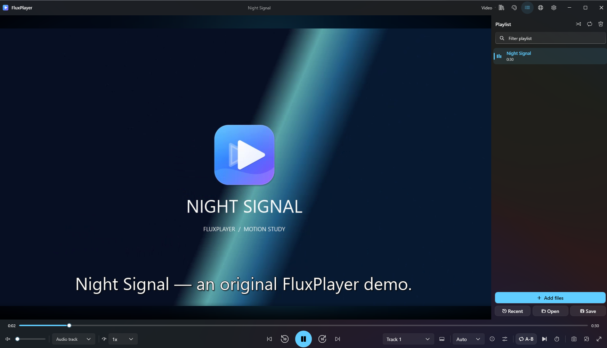
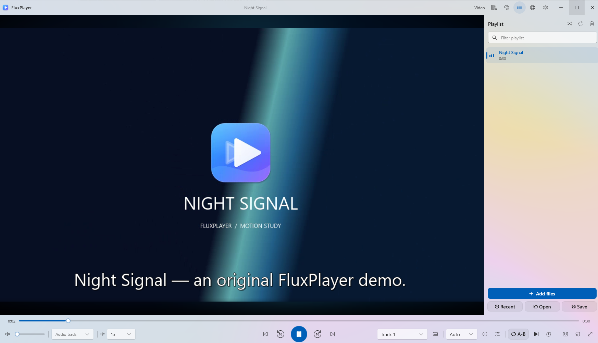
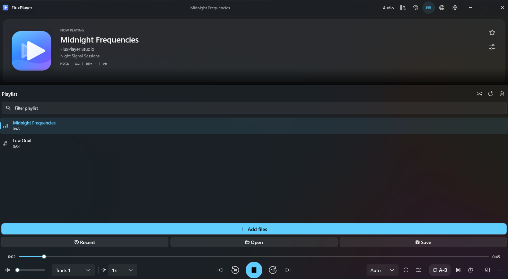
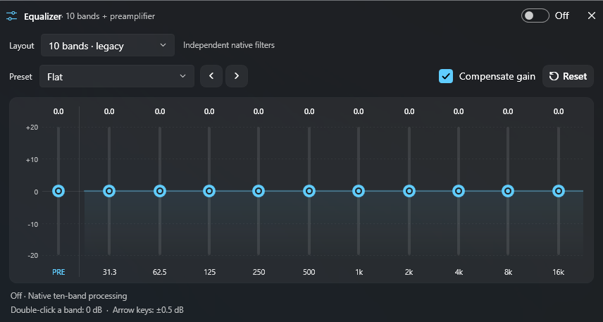

# Changelog

**English** · [Español](CHANGELOG.md)

Notable FluxPlayer changes since the first release. Earlier milestones are recorded by date and commit.

## [Unreleased]

### Changed

- The project page and 1.4.0 notes now have matching English and Spanish coverage, with screenshots of all four themes.

## [1.4.0] - 2026-11-12

### Highlights

- **First public Windows x64 release.** The setup executable and portable ZIP include .NET and LibVLC. SHA-256 sums accompany both downloads.
- **Two playback workspaces.** Music has artwork, synchronized lyrics and a playlist. Video has external subtitles, timeline previews, theater controls and bookmarks.
- **Fluent appearance.** Choose Dark Mica, Light Mica, Acrylic Blur or Full Black. Settings and the player are available in English and Spanish.
- **Local media tools.** Use the library, EQ, chapter editors and production panels for files you manage, with optional integrations for connected media.

### Added

- **Video navigation.** Timeline and playlist thumbnails, A–B repeat, a bookmark manager, frame capture, 360° view, pixel shaders and deinterlacing modes.
- **Track and subtitle workflows.** External audio and subtitle tracks, bilingual text subtitles, timing adjustment, subtitle tools, OCR, translation providers, and support for configured Whisper and Faster-Whisper tools.
- **Library and playlists.** Folder indexing, smart lists, favorites, ratings, history, labels, duplicate review, sorting, playlist import and export, and batch metadata tools.
- **Audio processing.** Graphic EQ in 10/15/20/31 bands, parametric EQ, channel routing, independent outputs, signal measurements, continuous PCM gapless and crossfade, and optional ASIO paths.
- **Production tools.** Audio extraction, mixing, conversion, subtitle and Matroska editing, offline audio effects and video filters. Some tools require a separate installation.
- **Connected media.** Supported Jellyfin, Emby, Plex and Subsonic libraries, WebDAV, UPnP, casting and authenticated mobile control. The feature inventory tracks coverage by integration.
- **Windows controls.** Mouse gestures, customizable shortcuts and context menu, mini player, tray controls, optional startup and separate portable or named profiles.

### Screenshots

### Changed

- **Player and tools.** The context menu groups controls by task, settings are searchable and the feature screen shows actionable switches.
- **Windows 11 styling.** The player uses Fluent controls, updated window materials and themed dialogs. Spanish text coverage extends to settings and service messages.
- **Distribution.** Setup offers English and Spanish. The separate Store MSIX uses a development identity during local validation.

### Fixed

- **Playlist timing.** Fixed incorrect duration handling found during playback checks.
- **Blackout window and bookmarks.** Fixed the blackout window behavior and bookmark layout found during desktop checks.
- **Subtitle handoff.** Opening subtitles with an existing instance forwards the request to the running player.
- **Audio and timing.** Preserve flat EQ level, remember output settings independently and keep millisecond precision when writing LRC timestamps.

**Installer signature.** Unsigned / Sin firma. Verify the file with `SHA256SUMS.txt`. The development MSIX passed overall local validation. Microsoft Store certification is pending.

## Source milestones before 1.4.0

| Date | Changes | Commit |
|---|---|---|
| 2026-11-08 | Fluent player, themed dialogs and more Spanish translations. | [1e38d96](https://github.com/cbatista96/FluxPlayer/commit/1e38d96) |
| 2026-11-02 | Translation engines, Faster-Whisper, playlist thumbnails, 360° video, shaders, external tracks, gestures and searchable settings. | [dbb1db1](https://github.com/cbatista96/FluxPlayer/commit/dbb1db1) |
| 2026-11-02 | Large capability batches, desktop window smoke checks and isolated media-server integration tests. | [ea9d281](https://github.com/cbatista96/FluxPlayer/commit/ea9d281) |
| 2026-10-23 | Categorized media tools and synchronized lyric editing with precise timestamps. | [56537ee](https://github.com/cbatista96/FluxPlayer/commit/56537ee) |
| 2026-10-22 | Initial source, isolated profiles, library restore, subtitle timing, native DSP, channel routing and advanced chapters. | [cbf7021](https://github.com/cbatista96/FluxPlayer/commit/cbf7021) |

[1.4.0]: https://github.com/cbatista96/FluxPlayer/releases/tag/v1.4.0
