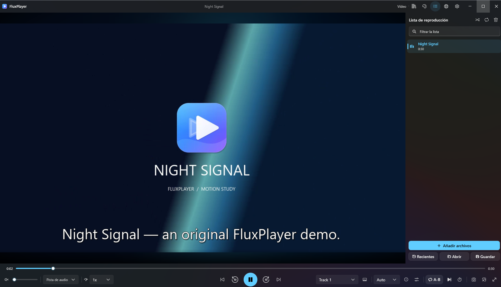
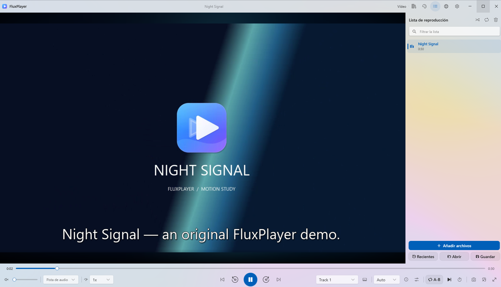
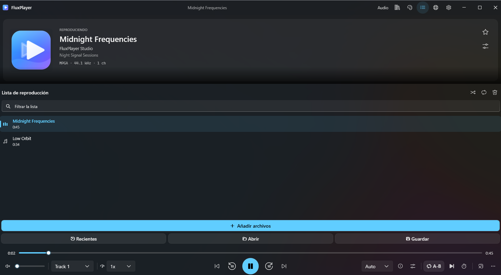
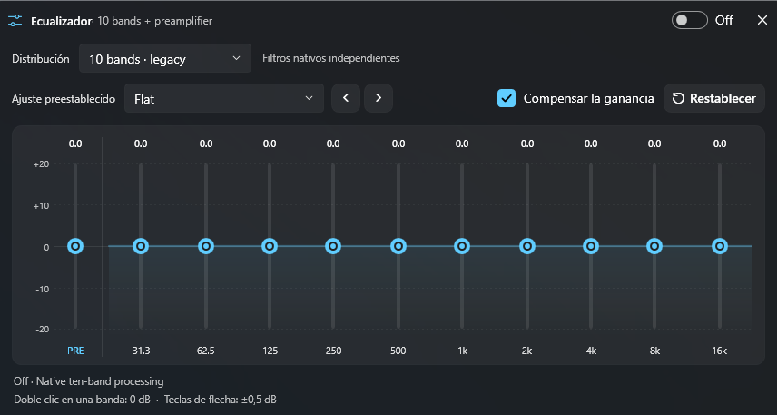

# Historial de cambios

[English](CHANGELOG.en.md) · **Español**

Cambios de FluxPlayer desde la primera publicación. Los hitos anteriores se registran por fecha y commit.

## [Sin publicar]

### Cambiado

- La página del proyecto y las notas de 1.4.0 ahora tienen la misma cobertura en inglés y español, con capturas de los cuatro temas.

## [1.4.0] - 2026-11-12

### Destacados

- **Primera publicación para Windows x64.** El instalador y el ZIP portátil incluyen .NET y LibVLC. Ambas descargas tienen sumas SHA-256.
- **Dos espacios de reproducción.** Música tiene carátulas, letras sincronizadas y lista de reproducción. Video tiene subtítulos externos, vistas previas, controles de cine y marcadores.
- **Apariencia Fluent.** Elige Mica oscuro, Mica claro, Acrílico o Negro total. El reproductor y los ajustes están disponibles en inglés y español.
- **Herramientas multimedia locales.** Usa la biblioteca, el ecualizador, los editores de capítulos y los paneles de producción para tus archivos, con integraciones opcionales para medios conectados.

### Añadido

- **Navegación de video.** Miniaturas de línea de tiempo y listas, repetición A–B, gestor de marcadores, captura de fotogramas, vista 360°, sombreadores y modos de desentrelazado.
- **Pistas y subtítulos.** Audio y subtítulos externos, subtítulos de texto bilingües, ajuste de tiempos, herramientas de subtítulos, OCR, proveedores de traducción y compatibilidad con Whisper y Faster-Whisper configurados.
- **Biblioteca y listas.** Indexado de carpetas, listas inteligentes, favoritos, valoraciones, historial, etiquetas, revisión de duplicados, ordenación, importación y exportación de listas y edición de metadatos por lotes.
- **Procesamiento de audio.** EQ gráfico de 10/15/20/31 bandas, EQ paramétrico, enrutamiento de canales, salidas independientes, mediciones de señal, PCM continuo sin pausas y con fundido, y rutas ASIO opcionales.
- **Herramientas de producción.** Extracción, mezcla y conversión de audio, edición de subtítulos y Matroska, efectos de audio y filtros de video fuera de línea. Algunas herramientas se instalan aparte.
- **Medios conectados.** Bibliotecas compatibles de Jellyfin, Emby, Plex y Subsonic, WebDAV, UPnP, transmisión a dispositivos y control móvil autenticado. El inventario detalla la cobertura de cada integración.
- **Controles de Windows.** Gestos del ratón, atajos y menú contextual personalizables, minirreproductor, controles de bandeja, inicio opcional y perfiles portátiles o con nombre.

### Capturas

### Cambiado

- **Reproductor y herramientas.** El menú contextual agrupa controles por tarea, los ajustes se pueden buscar y la pantalla de funciones muestra interruptores utilizables.
- **Estilo de Windows 11.** El reproductor usa controles Fluent, materiales de ventana actualizados y diálogos con tema. La cobertura en español se amplía a los ajustes y los mensajes de servicios.
- **Distribución.** El instalador ofrece inglés y español. El MSIX para Store usa una identidad de desarrollo durante la validación local.

### Corregido

- **Tiempos de listas.** Se corrigió el tratamiento incorrecto de duraciones detectado en las pruebas de reproducción.
- **Ventana de oscurecimiento y marcadores.** Se corrigieron el comportamiento de esa ventana y la disposición de los marcadores detectados en pruebas de escritorio.
- **Entrega de subtítulos.** Al abrir subtítulos con una instancia existente, la solicitud llega al reproductor que está abierto.
- **Audio y tiempos.** Se conserva el nivel con el ecualizador plano, los ajustes por salida se recuerdan por separado y se mantiene la precisión de milisegundos al guardar LRC.

**Firma del instalador.** Unsigned / Sin firma. Comprueba el archivo con `SHA256SUMS.txt`. La validación local del MSIX de desarrollo obtuvo aprobado general. La certificación de Microsoft Store está pendiente.

## Hitos del código antes de 1.4.0

| Fecha | Cambios | Commit |
|---|---|---|
| 2026-11-08 | Reproductor Fluent, diálogos con tema y más traducciones al español. | [1e38d96](https://github.com/cbatista96/FluxPlayer/commit/1e38d96) |
| 2026-11-02 | Motores de traducción, Faster-Whisper, miniaturas, video 360°, sombreadores, pistas externas, gestos y ajustes con búsqueda. | [dbb1db1](https://github.com/cbatista96/FluxPlayer/commit/dbb1db1) |
| 2026-11-02 | Lotes amplios de funciones, pruebas de apertura de ventanas y comprobaciones de integración con servidores multimedia aislados. | [ea9d281](https://github.com/cbatista96/FluxPlayer/commit/ea9d281) |
| 2026-10-23 | Herramientas multimedia por categorías y edición de letras sincronizadas con tiempos precisos. | [56537ee](https://github.com/cbatista96/FluxPlayer/commit/56537ee) |
| 2026-10-22 | Código inicial, perfiles aislados, restauración de biblioteca, sincronización de subtítulos, DSP nativo, enrutamiento y capítulos avanzados. | [cbf7021](https://github.com/cbatista96/FluxPlayer/commit/cbf7021) |

[1.4.0]: https://github.com/cbatista96/FluxPlayer/releases/tag/v1.4.0
