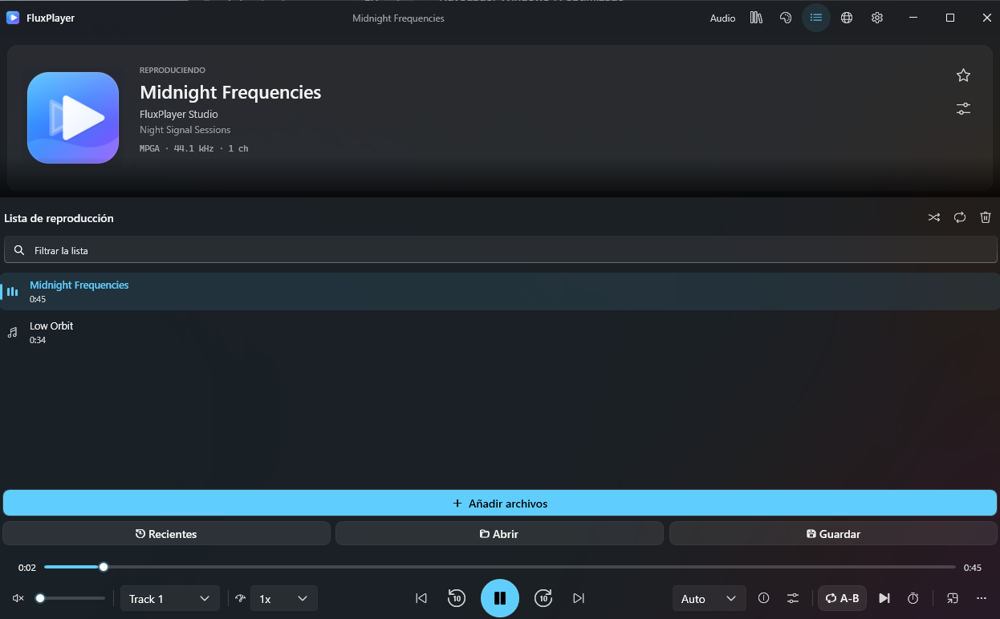

# FluxPlayer

**Reproductor de música y video de código abierto para Windows.**

[English](README.md) · [Descargas](https://github.com/cbatista96/FluxPlayer/releases/latest) · [Historial de versiones](CHANGELOG.md) · [Informar de un fallo](https://github.com/cbatista96/FluxPlayer/issues/new/choose)

## Descargar para Windows x64

- [Instalador EXE](https://github.com/cbatista96/FluxPlayer/releases/download/v1.4.0/FluxPlayerSetup-1.4.0-x64.exe): añade un acceso en Inicio y permite registrar asociaciones de archivos.
- [ZIP portátil](https://github.com/cbatista96/FluxPlayer/releases/download/v1.4.0/FluxPlayer-1.4.0-portable-x64.zip): extrae todos los archivos y abre FluxPlayer.exe.

Ambas descargas incluyen .NET y LibVLC. La aplicación está destinada a Windows 10 1809 o posterior; los materiales de Windows 11 dependen del sistema. La primera versión de GitHub se distribuye sin firma Authenticode y publica sumas SHA-256. La certificación de Microsoft Store está pendiente.

Abre un archivo con **Ctrl+O**. El modo música muestra carátulas, listas y letras LRC. El modo video ofrece subtítulos externos, ajuste de sincronía, marcadores y repetición A–B. También hay biblioteca local, ecualizador y temas claro y oscuro. La conversión, transcripción y algunos servicios conectados requieren herramientas o cuentas adicionales.

[Capturas](docs/screenshots/) · [Guía de usuario](docs/USER_GUIDE.md) · [Límites y registro de fallos](docs/KNOWN_ISSUES.md) · [Privacidad](docs/PRIVACY.md) · [Licencia GPL v3](LICENSE)
