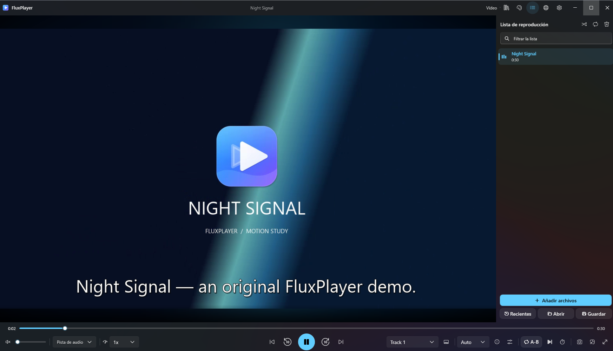
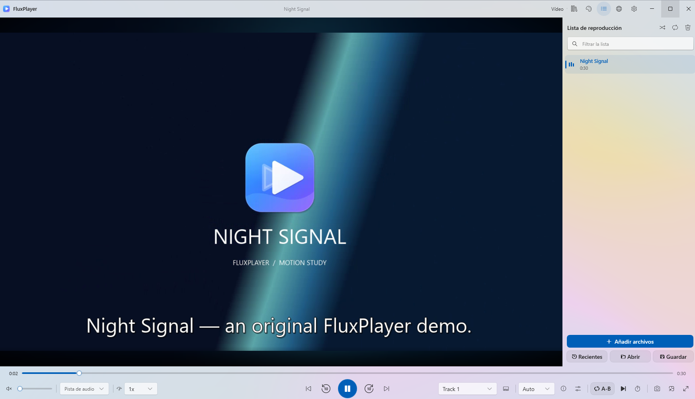
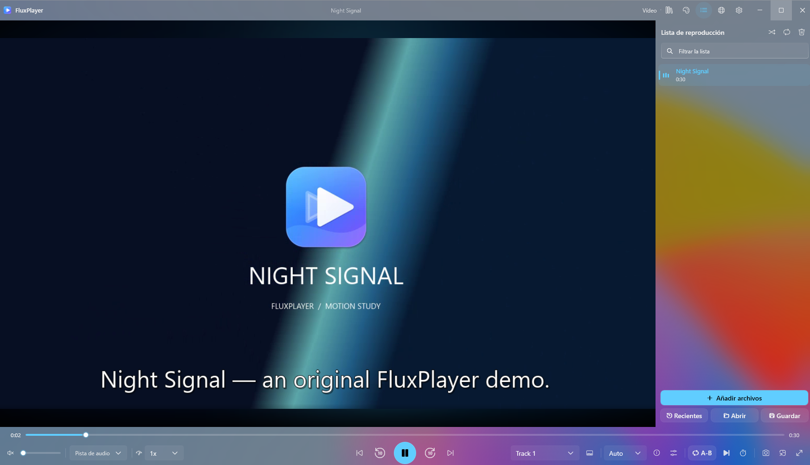
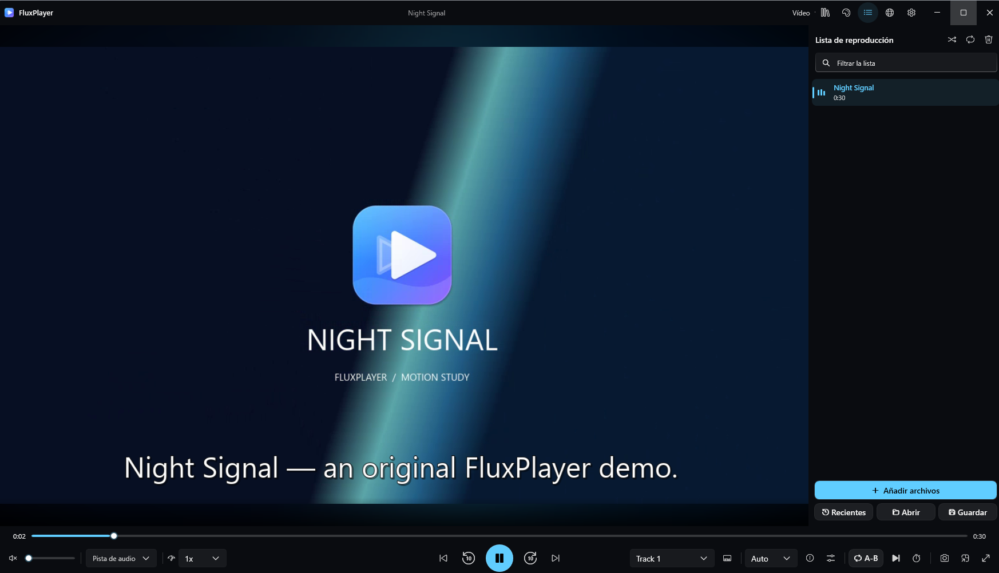
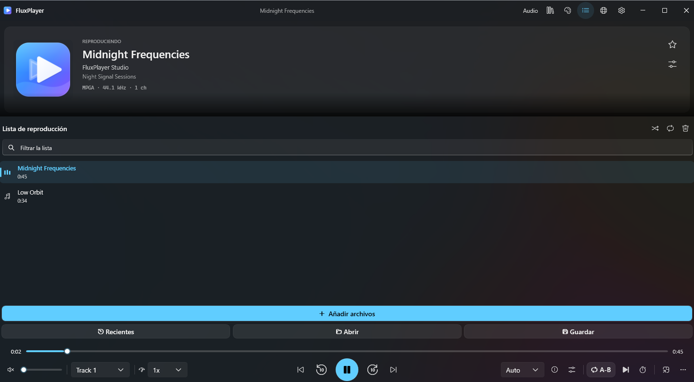
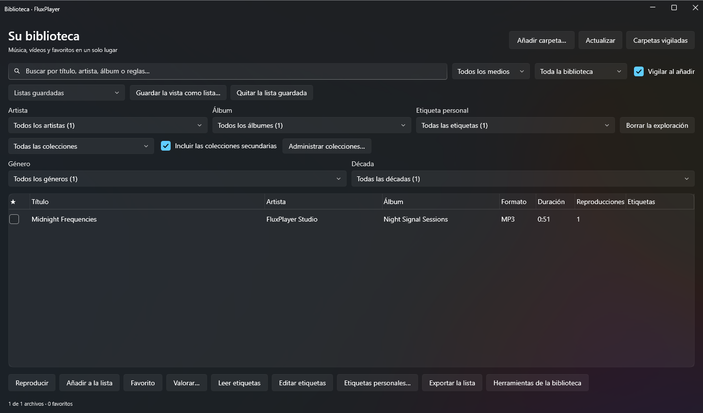
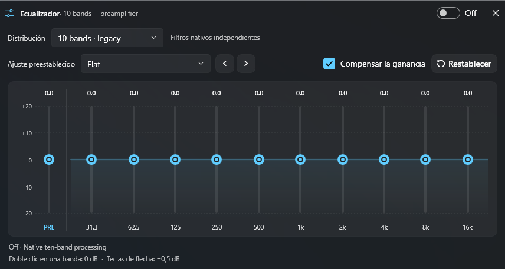
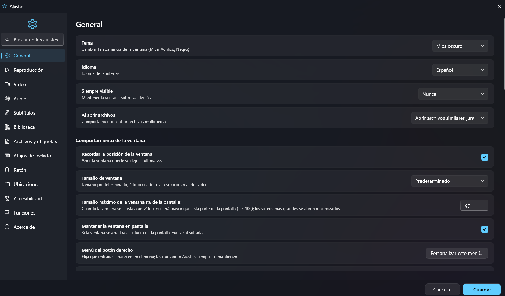

[English](README.md) · **Español** · [Changelog (English)](CHANGELOG.en.md) · [Historial (Español)](CHANGELOG.md)

<div align="center">


# FluxPlayer

**Reproductor de música y video de código abierto para Windows.**

Escucha con carátulas, letras sincronizadas y ecualizador. Mira videos con subtítulos, marcadores y controles de imagen. Organiza tu biblioteca y elige entre Mica oscuro, Mica claro, Acrílico y Negro total.

[](https://github.com/cbatista96/FluxPlayer/actions/workflows/ci.yml)
[](https://github.com/cbatista96/FluxPlayer/releases/latest)
[](https://github.com/cbatista96/FluxPlayer/releases)
[](LICENSE)
[](#requisitos)

### [Descargar FluxPlayer](https://github.com/cbatista96/FluxPlayer/releases/latest)

[Funciones](#todas-las-funciones) · [Capturas](#capturas) · [Historial](CHANGELOG.md) · [Informar de un fallo](https://github.com/cbatista96/FluxPlayer/issues/new/choose)



</div>

## Novedades de 1.4.0

- Primera descarga pública con instalador y ZIP portátil para Windows x64.
- Interfaz Fluent con cuatro temas, ajustes con búsqueda y controles en inglés y español.
- Miniaturas en la lista, gestos, repetición A–B, marcadores y pistas externas de audio y subtítulos.
- Vista 360°, sombreadores, desentrelazado y opciones de traducción y transcripción.

[Cambios completos con capturas](CHANGELOG.md) · [Notas de la versión](https://github.com/cbatista96/FluxPlayer/releases/tag/v1.4.0)

## Por qué usar FluxPlayer

| Para | Qué puedes hacer |
|---|---|
| **Reproducción y fuentes** | Elige la vista según las pistas decodificadas o selecciona Audio o Video manualmente. Cada espacio recuerda sus dimensiones. |
| **Música, audio y procesamiento de sonido** | Consulta carátulas y metadatos de las pistas. Carga letras LRC sincronizadas, edita los tiempos y guarda una nueva copia. |
| **Video, subtítulos y accesibilidad** | Ajusta aspecto, recorte, zoom, desplazamiento, rotación y desentrelazado. Las fuentes compatibles permiten vista 360°, selección de ojo estereoscópico y sombreadores de píxeles. |
| **Biblioteca, listas y archivos** | Indexa carpetas vigiladas y filtra por artista, álbum, género, etiquetas o colecciones. Crea listas inteligentes, explora medios relacionados y consulta favoritos y estadísticas. |
| **Red, servidores e interoperabilidad** | Conecta servidores compatibles de Jellyfin, Emby, Plex y Subsonic para explorar bibliotecas y usar las acciones de cada integración. |
| **Windows, temas y personalización** | Elige Mica oscuro, Mica claro, Negro total o Acrílico. Windows proporciona los efectos de fondo compatibles y cambia su aspecto con el foco de la ventana. |

## Descarga e instalación

| Archivo | Uso |
|---|---|
| [FluxPlayerSetup-1.4.0-x64.exe](https://github.com/cbatista96/FluxPlayer/releases/download/v1.4.0/FluxPlayerSetup-1.4.0-x64.exe) | Instala la aplicación con acceso en Inicio, asociaciones opcionales y desinstalador. |
| [FluxPlayer-1.4.0-portable-x64.zip](https://github.com/cbatista96/FluxPlayer/releases/download/v1.4.0/FluxPlayer-1.4.0-portable-x64.zip) | Extrae el ZIP completo y abre `FluxPlayer.exe`. Usa `--portable` para guardar los datos junto al ejecutable. |
| [SHA256SUMS.txt](https://github.com/cbatista96/FluxPlayer/releases/download/v1.4.0/SHA256SUMS.txt) | Comprueba la integridad de ambas descargas. |

El instalador actual se distribuye sin firma Authenticode. Verifica el archivo antes de abrirlo. [Política de firma](docs/CODE_SIGNING.md)

```powershell
Get-FileHash .\FluxPlayerSetup-1.4.0-x64.exe -Algorithm SHA256
```

Para desinstalar, abre Configuración de Windows › Aplicaciones › FluxPlayer. El desinstalador ofrece conservar o eliminar los ajustes.

### Requisitos

- Windows x64. La aplicación está destinada a Windows 10 1809 o posterior. Los fondos Mica y Acrílico dependen de Windows y sus ajustes visuales.
- El instalador y el ZIP incluyen .NET y LibVLC. La reproducción local funciona sin cuenta.
- La conversión, transcripción y algunas integraciones requieren herramientas o cuentas por separado.

## Inicio rápido

1. Abre un archivo con **Ctrl+O**, una dirección con **Ctrl+U** o arrastra medios al reproductor.
2. Selecciona **Automático**, **Audio** o **Video** en la barra superior. Pulsa **P** para ver la lista.
3. Pulsa **E** para el ecualizador, **L** para marcar un tramo A–B o **Ctrl+M** para el minirreproductor.
4. Abre Ajustes con **Ctrl+,** para cambiar el idioma, el tema, los atajos y las preferencias.

## Actualizaciones y notas de versión

Descarga las actualizaciones desde GitHub. Cada versión ofrece notas ilustradas, con inglés primero y español debajo. El paquete de Microsoft Store sigue pendiente de envío a certificación. [Versiones](https://github.com/cbatista96/FluxPlayer/releases) · [Preparación para Microsoft Store](docs/MICROSOFT_STORE.md)

## Informes de fallos, registros y privacidad

Incluye la versión de FluxPlayer, la compilación de Windows y los pasos para reproducir el fallo. El registro predeterminado está en `%LOCALAPPDATA%\FluxPlayer\logs\crash.log`. Quita rutas personales, URLs privadas y credenciales antes de adjuntarlo. [Fallos y límites conocidos](docs/KNOWN_ISSUES.md) · [Privacidad](docs/PRIVACY.md)

## Capturas

### Temas

Mica oscuro abre la página con el reproductor activo. Estas vistas muestran el mismo video en los otros tres temas.

<details>
<summary>Mica claro</summary>



</details>

<details>
<summary>Acrílico</summary>



</details>

<details>
<summary>Negro total</summary>



</details>

### Reproductor y herramientas

**Modo música y lista de reproducción**



<details>
<summary>Biblioteca y filtros</summary>



</details>

<details>
<summary>Ecualizador gráfico</summary>



</details>

<details>
<summary>Ajustes con búsqueda</summary>



</details>

[Ver las capturas a tamaño completo](docs/screenshots/)

## Todas las funciones

### Reproducción y fuentes

- **Modos automáticos de música y video.** Elige la vista según las pistas decodificadas o selecciona Audio o Video manualmente. Cada espacio recuerda sus dimensiones.
- **Archivos locales, discos y transmisiones.** Abre archivos y carpetas, arrastra medios al reproductor o abre una URL o disco compatible. El motor LibVLC incluido determina la compatibilidad de códecs.
- **Controles de reproducción.** Avanza con el teclado, cambia la velocidad, avanza fotograma a fotograma, mezcla la cola, elige la siguiente pista o marca A y B para repetir un tramo.
- **Reanudación, historial y sesiones.** Reanuda archivos compatibles, conserva el historial y vuelve a abrir sesiones guardadas. Las preferencias opcionales recuerdan el volumen y las pistas por archivo.
- **Marcadores, capítulos y segmentos.** Guarda posiciones, navega por capítulos, carga capítulos externos y define segmentos que reproducir, omitir o silenciar. Hay herramientas para CUE y ediciones avanzadas de Matroska.
- **Programación y TV.** Programa reproducción, alarmas o cambios de volumen. Usa el temporizador de suspensión o configura fuentes de TV compatibles para grabación y reproducción diferida.

### Música, audio y procesamiento de sonido

- **Carátulas, metadatos y letras.** Consulta carátulas y metadatos de las pistas. Carga letras LRC sincronizadas, edita los tiempos y guarda una nueva copia.
- **Ecualizadores gráfico y paramétrico.** Elige 10, 15, 20 o 31 bandas gráficas con ajustes preestablecidos y compensación de ganancia. Usa el ecualizador paramétrico para actuar sobre frecuencias concretas.
- **Salida y enrutamiento.** Elige un dispositivo, ajusta el retardo y ReplayGain, enruta canales o mezcla a estéreo y guarda ajustes por dispositivo. La salida avanzada incluye WASAPI y ASIO donde son compatibles.
- **DSP y reproducción continua.** Ajusta graves, amplitud estéreo y dinámica, configura la cadena de señal y usa reproducción sin pausas o fundidos en la ruta PCM continua. Las zonas independientes pueden usar salidas distintas.
- **Mediciones y audio sin conexión.** Consulta niveles y la ruta de señal, mide RMS, pico real estimado y BPM y exporta el análisis. Las herramientas fuera de línea incluyen efectos, restauración y masterización multicanal.

### Video, subtítulos y accesibilidad

- **Controles de imagen.** Ajusta aspecto, recorte, zoom, desplazamiento, rotación y desentrelazado. Las fuentes compatibles permiten vista 360°, selección de ojo estereoscópico y sombreadores de píxeles.
- **Línea de tiempo, pantalla completa y captura.** Previsualiza posiciones con miniaturas, usa los controles de cine y el panel sobre el video, captura fotogramas u hojas de contacto y consulta los diagnósticos del renderizador.
- **Pistas de audio y subtítulos.** Selecciona pistas incrustadas o abre audio y subtítulos externos. Ajusta retardo, estilo y posición y muestra juntas dos pistas externas de subtítulos de texto.
- **Edición de subtítulos, OCR y transcripción.** Busca o corrige tiempos, valida y convierte archivos de subtítulos, reconoce texto de imágenes con el OCR instalado y usa herramientas Whisper configuradas para transcribir audio.
- **Traducción y descarga de subtítulos.** Busca subtítulos y traduce texto con servicios configurados o motores locales compatibles. Los requisitos dependen del proveedor.

### Biblioteca, listas y archivos

- **Biblioteca y vistas inteligentes.** Indexa carpetas vigiladas y filtra por artista, álbum, género, etiquetas o colecciones. Crea listas inteligentes, explora medios relacionados y consulta favoritos y estadísticas.
- **Listas y colas.** Importa y exporta M3U/M3U8, PLS y XSPF, reordena, filtra o clasifica entradas y consulta duraciones y miniaturas cuando estén disponibles.
- **Mantenimiento de archivos y metadatos.** Edita etiquetas compatibles de forma individual o por lotes, previsualiza renombrados, revisa duplicados y repara rutas de archivos movidos mediante coincidencias SHA-256.
- **Fotos y medios en archivos comprimidos.** Explora fotos locales, inicia presentaciones, abre medios compatibles desde ZIP y exporta una selección a una carpeta del dispositivo.
- **Pódcast y audiolibros.** Suscríbete a fuentes RSS o Atom, importa y exporta suscripciones OPML y descarga episodios para escucharlos sin conexión. Los audiolibros guardan su progreso, velocidad y marcadores por separado.
- **Producción y conversión.** Con herramientas FFmpeg compatibles, crea copias convertidas, extrae audio seleccionado, une pistas, mezcla WAV o FLAC, exporta un fragmento y aplica filtros de video fuera de línea.

### Red, servidores e interoperabilidad

- **Servidores multimedia personales.** Conecta servidores compatibles de Jellyfin, Emby, Plex y Subsonic para explorar bibliotecas y usar las acciones de cada integración.
- **Dispositivos de red y controles remotos.** Descubre dispositivos UPnP compatibles, transmite a un receptor Chromecast o DLNA donde se admita o usa el control remoto opcional autenticado para móvil y navegador.
- **Fuentes en línea y metadatos.** Abre fuentes en línea compatibles con yt-dlp configurado, consulta metadatos públicos, sincroniza datos del catálogo por WebDAV y usa servicios de historial de escucha opcionales.
- **mpv, Kodi y MPD.** Usa la sesión alternativa de mpv si está instalado. Las operaciones de Kodi y MPD tienen estados de verificación individuales en el inventario.
- **Control local y extensiones.** Conecta un script o controlador externo al reproductor mediante las interfaces locales autenticadas. El cliente de control puede enviar órdenes de reproducción y cola. Las extensiones configuradas pueden añadir acciones.

### Windows, temas y personalización

- **Cuatro temas.** Elige Mica oscuro, Mica claro, Negro total o Acrílico. Windows proporciona los efectos de fondo compatibles y cambia su aspecto con el foco de la ventana.
- **Búsqueda en ajustes y controles personalizables.** Encuentra ajustes por categoría o búsqueda, organiza el menú del reproductor y configura atajos de teclado, gestos del ratón y controles en pantalla.
- **Minirreproductor y controles de Windows.** Usa el reproductor compacto, la bandeja y las teclas multimedia. Los accesos, las asociaciones de archivos y el inicio opcional integran la aplicación con Windows.
- **Monitores y mandos.** Elige la pantalla completa, oscurece los demás monitores, recuerda posiciones de ventanas o usa un mando XInput. Las acciones de energía opcionales pueden suspender, hibernar o apagar Windows al terminar la reproducción.
- **Perfiles y uso portátil.** Separa los ajustes y el estado de la biblioteca con perfiles con nombre, un directorio de datos personalizado o el modo portátil. Usa la interfaz en inglés o español.
- **Diagnósticos locales.** Consulta el registro de fallos y los diagnósticos opcionales de reproducción cuando investigues un problema y publica un informe reproducible en GitHub.

El inventario técnico enumera las **1.202 capacidades individuales** e indica cuáles se verificaron, cuáles están implementadas y pendientes de prueba, y cuáles siguen pendientes de implementación. [Inventario completo y evidencia](FEATURES.md)

## Documentación

| Documento | Contenido |
|---|---|
| [Guía de usuario (inglés)](docs/USER_GUIDE.md) | Atajos, reproducción y ajustes detallados. |
| [Procesamiento de audio y video (inglés)](docs/AUDIO_VIDEO_PROCESSING.md) | Flujos de producción, medición y límites. |
| [Arquitectura y pruebas (inglés)](docs/ARCHITECTURE.md) | Componentes, interfaces y estructura. |
| [Historial](CHANGELOG.md) | Novedades, cambios, correcciones y capturas. |

## Versiones y compilación

```powershell
git clone https://github.com/cbatista96/FluxPlayer.git
cd FluxPlayer
dotnet build FluxPlayer.sln -c Release -p:Platform=x64
```

[Requisitos de compilación](docs/BUILDING.md) · [Pruebas](docs/TESTING.md)

## Contribuir

Busca incidencias existentes, describe los pasos para reproducir un fallo y adjunta únicamente diagnósticos revisados. [Guía de contribución](CONTRIBUTING.md)

## Licencia

FluxPlayer se distribuye bajo GPL v3. Las dependencias conservan sus propias licencias. [Licencia](LICENSE) · [Avisos de terceros](THIRD_PARTY_NOTICES.md)
