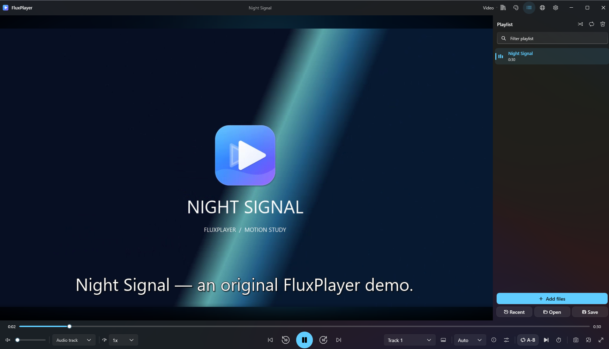
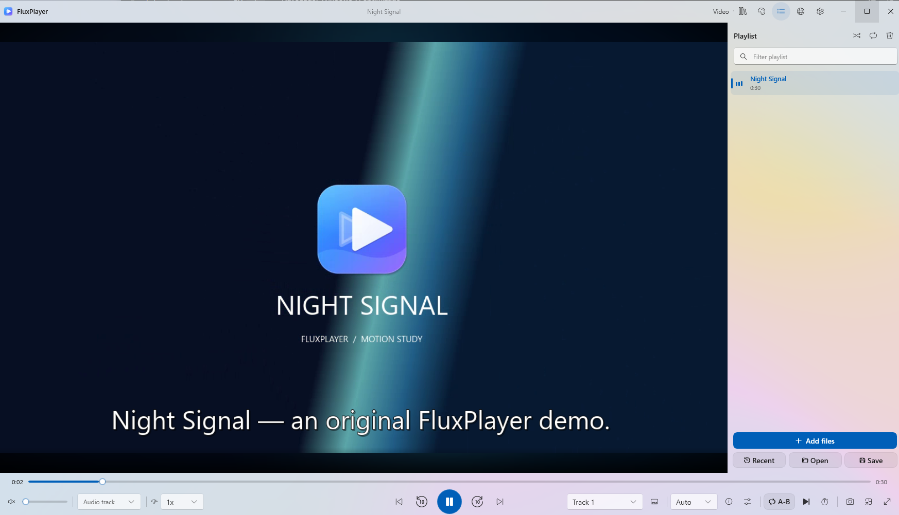
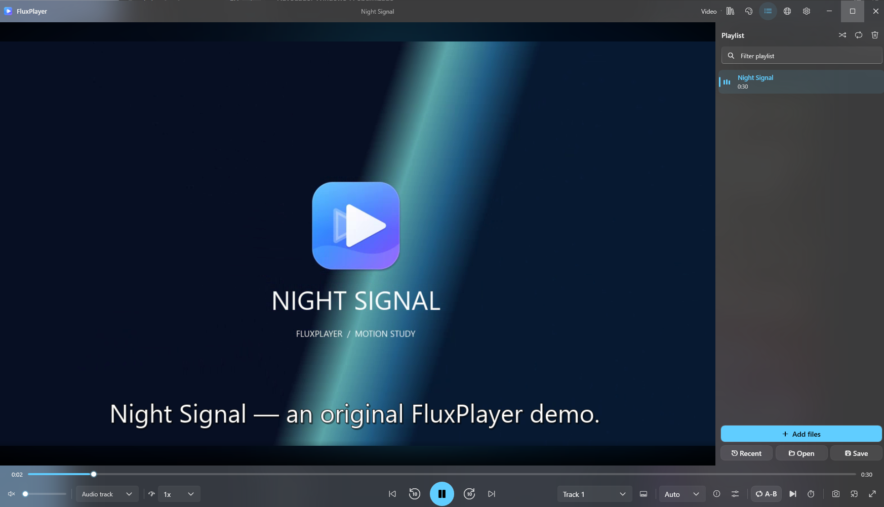
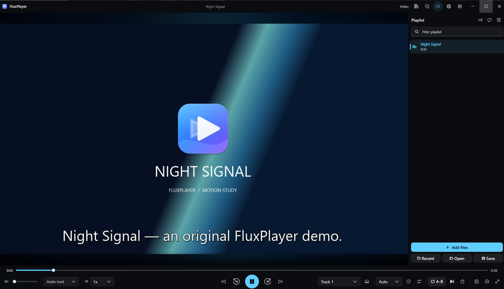
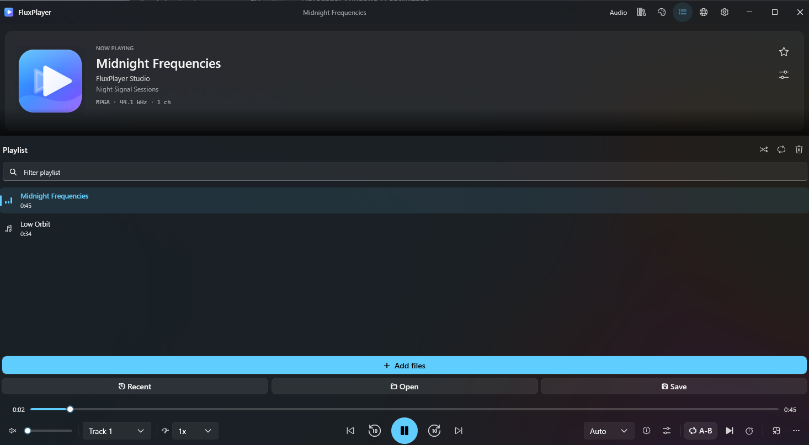
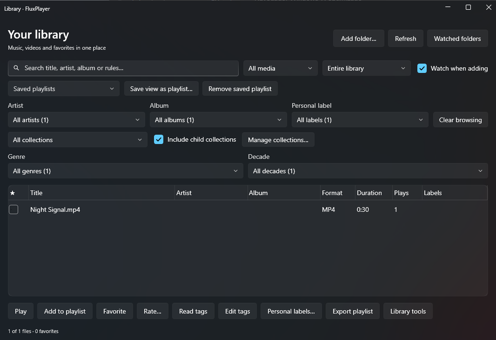
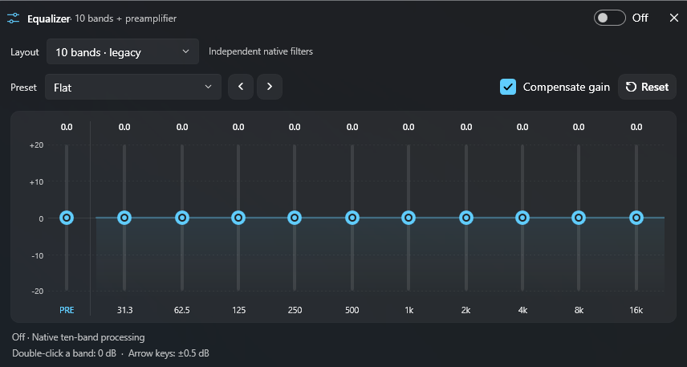
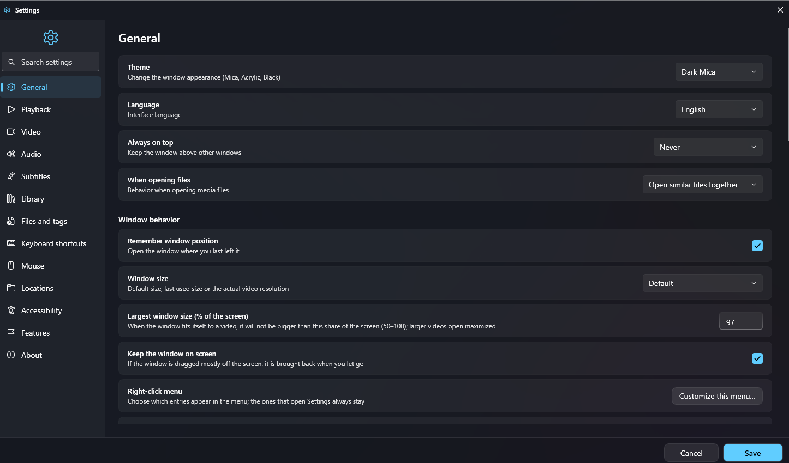

**English** · [Español](README.es.md) · [Changelog (English)](CHANGELOG.en.md) · [Historial (Español)](CHANGELOG.md)

<div align="center">


# FluxPlayer

**An open source Windows player for music and video.**

Listen with artwork, synchronized lyrics and an equalizer. Watch with subtitles, bookmarks and picture controls. Organize your library and choose Dark Mica, Light Mica, Acrylic Blur or Full Black.

[](https://github.com/cbatista96/FluxPlayer/actions/workflows/ci.yml)
[](https://github.com/cbatista96/FluxPlayer/releases/latest)
[](https://github.com/cbatista96/FluxPlayer/releases)
[](LICENSE)
[](#requirements)

### [Download FluxPlayer](https://github.com/cbatista96/FluxPlayer/releases/latest)

[Features](#all-features) · [Screenshots](#screenshots) · [Changelog](CHANGELOG.en.md) · [Report a bug](https://github.com/cbatista96/FluxPlayer/issues/new/choose)



</div>

## New in 1.4.0

- First public Windows x64 download with a setup executable and portable ZIP.
- Fluent interface with four themes, searchable settings and English and Spanish controls.
- Playlist thumbnails, gestures, A–B repeat, bookmarks and external audio and subtitle tracks.
- 360° view, pixel shaders, deinterlacing, and optional translation and transcription.

[Full changelog with screenshots](CHANGELOG.en.md) · [Release notes](https://github.com/cbatista96/FluxPlayer/releases/tag/v1.4.0)

## Why FluxPlayer

| For | What you can do |
|---|---|
| **Playback and sources** | Choose the layout from the decoded tracks or select Audio or Video manually. Each workspace remembers its dimensions. |
| **Music, audio and sound processing** | See album art and track metadata. Load synchronized LRC lyrics, edit timestamps and save a new lyrics copy. |
| **Video, subtitles and accessibility** | Adjust aspect, crop, zoom, pan, rotation and deinterlacing. Supported sources can use 360° view, stereoscopic eye selection and pixel shaders. |
| **Library, playlists and files** | Index watched folders and filter by artist, album, genre, labels or collections. Build smart lists, browse related media and revisit favorites and playback statistics. |
| **Network, servers and interoperability** | Connect supported Jellyfin, Emby, Plex and Subsonic servers to browse libraries and use the actions exposed by each adapter. |
| **Windows, themes and personalization** | Choose Dark Mica, Light Mica, Full Black or Acrylic Blur. Windows supplies supported backdrop effects and changes their appearance with window focus. |

## Download and install

| File | Purpose |
|---|---|
| [FluxPlayerSetup-1.4.0-x64.exe](https://github.com/cbatista96/FluxPlayer/releases/download/v1.4.0/FluxPlayerSetup-1.4.0-x64.exe) | Install with a Start menu shortcut, optional file associations and an uninstaller. |
| [FluxPlayer-1.4.0-portable-x64.zip](https://github.com/cbatista96/FluxPlayer/releases/download/v1.4.0/FluxPlayer-1.4.0-portable-x64.zip) | Extract the entire ZIP and run `FluxPlayer.exe`. Use `--portable` to keep data next to the executable. |
| [SHA256SUMS.txt](https://github.com/cbatista96/FluxPlayer/releases/download/v1.4.0/SHA256SUMS.txt) | Verify both downloads. |

The current installer is unsigned. Verify the file before opening it. [Code signing policy](docs/CODE_SIGNING.md)

```powershell
Get-FileHash .\FluxPlayerSetup-1.4.0-x64.exe -Algorithm SHA256
```

To uninstall, open Windows Settings › Apps › FluxPlayer. The uninstaller offers to retain or remove settings.

### Requirements

- Windows x64. The app targets Windows 10 1809 or later. Mica and Acrylic backdrops depend on Windows and its visual settings.
- Setup and ZIP include .NET and LibVLC. Local playback works without an account.
- Conversion, transcription and some integrations require separate tools or accounts.

## Quick start

1. Press **Ctrl+O** to open a file or **Ctrl+U** for a URL, or drag media into the player.
2. Select **Automatic**, **Audio** or **Video** in the top bar. Press **P** to show the playlist.
3. Press **E** for the equalizer, **L** to mark an A–B section or **Ctrl+M** for the mini player.
4. Open Settings with **Ctrl+,** to choose the language, theme, shortcuts and preferences.

## Updates and release notes

Download updates from GitHub. Each release includes illustrated notes with English first and Spanish below. The Microsoft Store package is awaiting submission for certification. [Releases](https://github.com/cbatista96/FluxPlayer/releases) · [Microsoft Store preparation](docs/MICROSOFT_STORE.md)

## Bug reports, local logs and privacy

Include the FluxPlayer version, Windows build and steps to reproduce the problem. The default crash log is `%LOCALAPPDATA%\FluxPlayer\logs\crash.log`. Remove personal paths, private URLs and credentials before attaching it. [Known issues and limits](docs/KNOWN_ISSUES.md) · [Privacy](docs/PRIVACY.md)

## Screenshots

### Themes

Dark Mica opens this page with the player active. These views show the same video in the other three themes.

<details>
<summary>Light Mica</summary>



</details>

<details>
<summary>Acrylic Blur</summary>



</details>

<details>
<summary>Full Black</summary>



</details>

### Player and tools

**Music workspace and playlist**



<details>
<summary>Library and filters</summary>



</details>

<details>
<summary>Graphic equalizer</summary>



</details>

<details>
<summary>Searchable settings</summary>



</details>

[Open full-size screenshots](docs/screenshots/)

## All features

### Playback and sources

- **Automatic music and video modes.** Choose the layout from the decoded tracks or select Audio or Video manually. Each workspace remembers its dimensions.
- **Local files, discs and streams.** Open files and folders, drag media into the player, or open a supported network URL or disc. The included LibVLC engine determines codec support.
- **Playback controls.** Seek by keyboard, change speed, step forward by frame, shuffle, queue a track next, or mark A and B to repeat a section.
- **Resume, history and sessions.** Resume supported files, keep playback history and reopen saved sessions. Optional preferences remember volume and track selections per file.
- **Bookmarks, chapters and segments.** Save positions, navigate chapters, load external chapters and define segments to play, skip or mute. Tools cover CUE and advanced Matroska editions.
- **Scheduling and TV.** Schedule playback, alarms or volume changes. Use the sleep timer or configure supported TV sources for recording and time shifting.

### Music, audio and sound processing

- **Artwork, metadata and lyrics.** See album art and track metadata. Load synchronized LRC lyrics, edit timestamps and save a new lyrics copy.
- **Graphic and parametric equalizers.** Choose 10, 15, 20 or 31 graphic bands with presets and gain compensation. Use parametric controls to target specific frequencies.
- **Output and routing.** Choose an output device, adjust delay and ReplayGain, route channels or downmix, and save settings per device. Advanced output includes WASAPI and ASIO where supported.
- **DSP and continuous playback.** Shape bass, width and dynamics, configure the signal chain, and use gapless playback or crossfade on the continuous PCM path. Independent zones can use separate outputs.
- **Measurements and offline audio.** Inspect levels and signal path, measure RMS, estimated true peak and BPM, and export analysis. Offline tools include effects, restoration and multichannel mastering.

### Video, subtitles and accessibility

- **Viewing controls.** Adjust aspect, crop, zoom, pan, rotation and deinterlacing. Supported sources can use 360° view, stereoscopic eye selection and pixel shaders.
- **Timeline, fullscreen and capture.** Preview positions with timeline thumbnails, use theater controls and the video HUD, capture frames or contact sheets, and inspect renderer diagnostics.
- **Audio and subtitle tracks.** Select embedded tracks or open external audio and subtitles. Adjust delay, style and placement and display two external text subtitle tracks together.
- **Subtitle editing, OCR and transcription.** Search or correct timing, validate and convert subtitle files, recognize image text with installed OCR support, and use configured Whisper tools to transcribe audio.
- **Translation and subtitle downloads.** Look up subtitles and translate text with configured services or local engines where supported. Requirements depend on the provider.

### Library, playlists and files

- **Library and smart views.** Index watched folders and filter by artist, album, genre, labels or collections. Build smart lists, browse related media and revisit favorites and playback statistics.
- **Playlists and queues.** Import and export M3U/M3U8, PLS and XSPF, reorder entries, filter or sort them, and browse tracks with durations and thumbnails where available.
- **File and metadata maintenance.** Edit supported tags individually or in batches, preview renaming, review duplicate entries and repair paths to moved files using a SHA-256 match.
- **Photos and archive media.** Browse local photos, play slideshows, open supported media from ZIP archives and export selected media to a device folder.
- **Podcasts and audiobooks.** Subscribe to RSS or Atom feeds, import and export OPML subscriptions, and download episodes for offline listening. Audiobooks keep separate progress, speed and bookmarks.
- **Production and conversion.** With compatible FFmpeg tools, create converted copies, extract selected audio, join tracks, mix WAV or FLAC, export a clip and apply offline video filters.

### Network, servers and interoperability

- **Personal media servers.** Connect supported Jellyfin, Emby, Plex and Subsonic servers to browse libraries and use the actions exposed by each adapter.
- **Network devices and remotes.** Discover compatible UPnP devices, send playback to a Chromecast or DLNA receiver where supported, or use the optional authenticated mobile and browser remote.
- **Online sources and metadata.** Open supported online sources through a configured yt-dlp, look up public metadata, synchronize catalog data over WebDAV and use optional listening services.
- **mpv, Kodi and MPD.** Use the alternate mpv session when installed. Kodi and MPD operations have individual verification statuses in the feature inventory.
- **Local control and extensions.** Connect a script or an external controller to the running player through the authenticated local interfaces. The control client can send playback and queue commands. Configured extensions can add actions.

### Windows, themes and personalization

- **Four themes.** Choose Dark Mica, Light Mica, Full Black or Acrylic Blur. Windows supplies supported backdrop effects and changes their appearance with window focus.
- **Searchable settings and customizable input.** Find settings by category or search, organize the player menu and configure keyboard shortcuts, mouse gestures and on-screen controls.
- **Mini player and Windows controls.** Use the compact player, system tray and media keys. Optional shortcuts, file associations and startup integration connect the app to Windows.
- **Monitors and controllers.** Choose a fullscreen display, dim other screens, recall window positions or use an XInput controller. Optional power actions can sleep, hibernate or shut down Windows after playback.
- **Profiles and portable use.** Keep settings and library state separate with named profiles, a custom data directory or portable mode. Use English or Spanish in the interface.
- **Local diagnostics.** Consult the crash log and optional playback diagnostics when troubleshooting, then report a reproducible issue in GitHub.

The engineering inventory lists all **1,202 individual capabilities** and distinguishes verified, implemented but unverified, and pending items. [Full inventory and evidence](FEATURES.md)

## Documentation

| Document | Contents |
|---|---|
| [User guide](docs/USER_GUIDE.md) | Shortcuts, playback and detailed settings. |
| [Audio and video processing](docs/AUDIO_VIDEO_PROCESSING.md) | Production workflows, measurements and limits. |
| [Architecture and tests](docs/ARCHITECTURE.md) | Components, interfaces and structure. |
| [Changelog](CHANGELOG.en.md) | Highlights, changes, fixes and screenshots. |

## Versions and building

```powershell
git clone https://github.com/cbatista96/FluxPlayer.git
cd FluxPlayer
dotnet build FluxPlayer.sln -c Release -p:Platform=x64
```

[Build requirements](docs/BUILDING.md) · [Testing](docs/TESTING.md)

## Contribute

Search existing issues, include steps to reproduce a problem and attach only reviewed diagnostics. [Contribution guide](CONTRIBUTING.md)

## License

FluxPlayer is licensed under GPL v3. Dependencies retain their own licenses. [License](LICENSE) · [Third-party notices](THIRD_PARTY_NOTICES.md)
