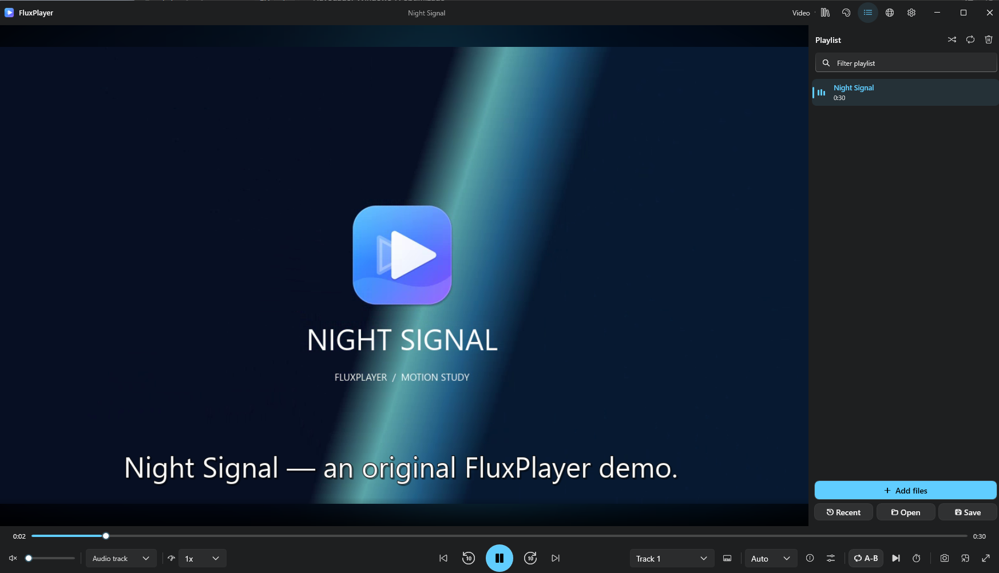

<div align="center">


# FluxPlayer

**An open source music and video player for Windows.**

[](https://github.com/cbatista96/FluxPlayer/releases/latest)
[](https://github.com/cbatista96/FluxPlayer/actions/workflows/ci.yml)
[](LICENSE)

[Español](README.es.md) · [Downloads](https://github.com/cbatista96/FluxPlayer/releases/latest) · [User guide](docs/USER_GUIDE.md) · [Changelog](CHANGELOG.md) · [Report a bug](https://github.com/cbatista96/FluxPlayer/issues/new/choose)

</div>



## Download

| Windows x64 | Use it when |
|---|---|
| [Setup EXE](https://github.com/cbatista96/FluxPlayer/releases/download/v1.4.0/FluxPlayerSetup-1.4.0-x64.exe) | You want Start menu shortcuts, optional file associations and an uninstaller. |
| [Portable ZIP](https://github.com/cbatista96/FluxPlayer/releases/download/v1.4.0/FluxPlayer-1.4.0-portable-x64.zip) | You want to extract and run the app without installing it. Extract the whole ZIP, then run FluxPlayer.exe. |

The downloads include .NET and LibVLC. Windows 10 1809 or later is the application target; Windows 11 visual effects depend on the OS. The first GitHub release is unsigned. See [verification and signing](docs/CODE_SIGNING.md) and the release's SHA-256 sums. Microsoft Store certification is pending.

## What you can do

| Workspace | Highlights |
|---|---|
| Music | Album art, synchronized LRC lyrics, playlists, favorites, graphic and parametric EQ. |
| Video | External and bilingual subtitles, subtitle timing, bookmarks, thumbnails, frame capture and A–B repeat. |
| Library | Local folders, smart playlists, duplicate review, history and portable profiles. |
| Windows | Light and dark Fluent themes, mini player, tray controls, global hotkeys and an English or Spanish interface. |
| Optional tools | Conversion, transcription, connected libraries, casting and translation with supported tools or accounts. |

[See the screenshot gallery](docs/screenshots/) · [Feature inventory and verification status](FEATURES.md) · [Known limits and crash logs](docs/KNOWN_ISSUES.md)

## Build from source

```powershell
git clone https://github.com/cbatista96/FluxPlayer.git
cd FluxPlayer
dotnet build FluxPlayer.sln -c Release -p:Platform=x64
dotnet run --project FluxPlayer/FluxPlayer.csproj -c Release -p:Platform=x64
```

See [build requirements](docs/BUILDING.md), [tests](docs/TESTING.md), [architecture](docs/ARCHITECTURE.md), [Store packaging](docs/MICROSOFT_STORE.md) and [contributing](CONTRIBUTING.md).

FluxPlayer is licensed under [GPL v3](LICENSE). Dependencies retain their own licenses; see [third-party notices](THIRD_PARTY_NOTICES.md). See also the [privacy policy](docs/PRIVACY.md).
