# FluxPlayer screenshots / Capturas de FluxPlayer

[English](#english) · [Español](#español)

## English

### Dark Mica with the active player

[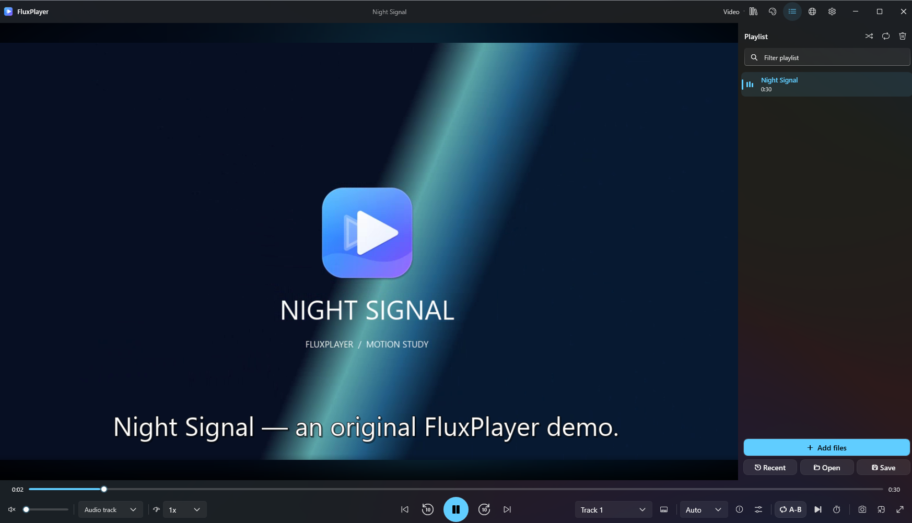](en/mica-dark.png)

### Light Mica

[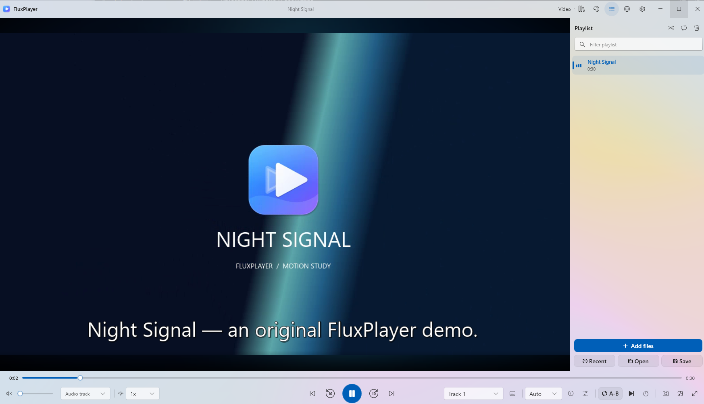](en/mica-light.png)

### Acrylic Blur

[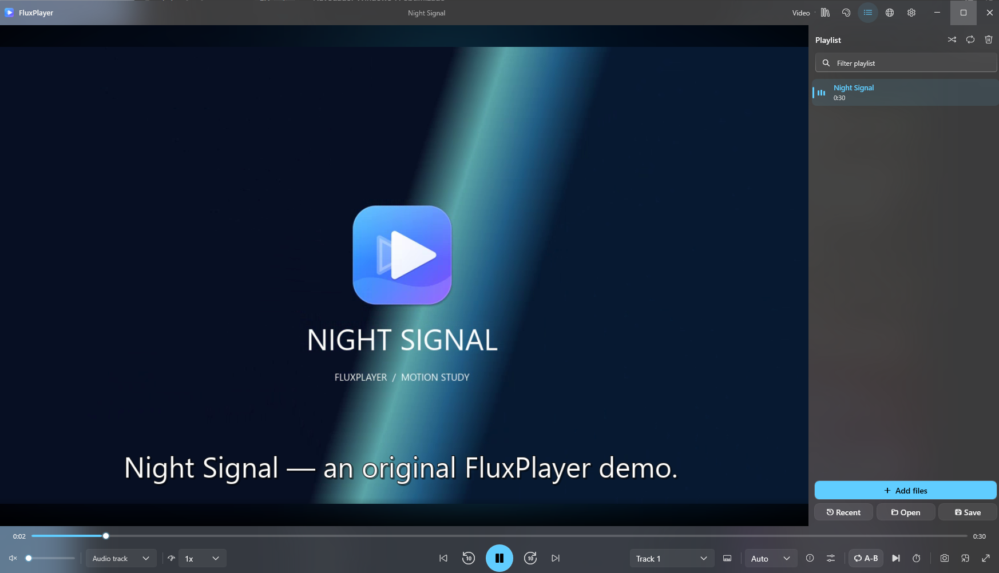](en/acrylic.png)

### Full Black

[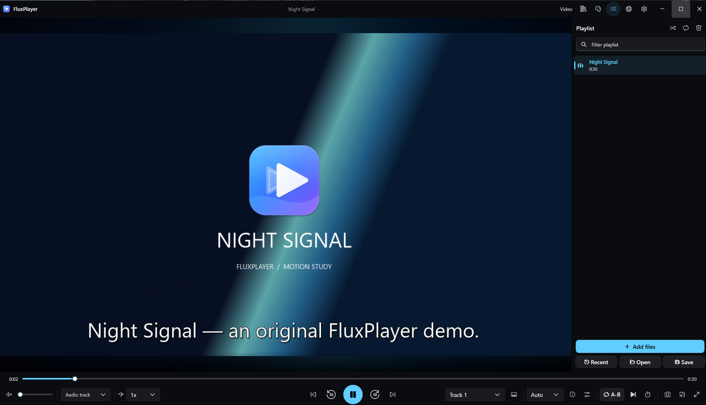](en/full-black.png)

### Music workspace and playlist

[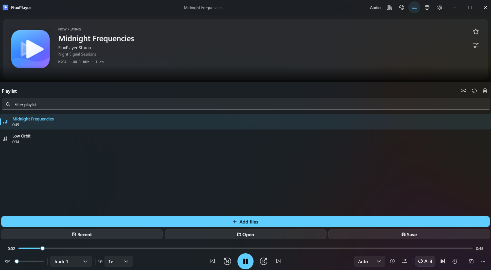](en/music.png)

### Library and filters

[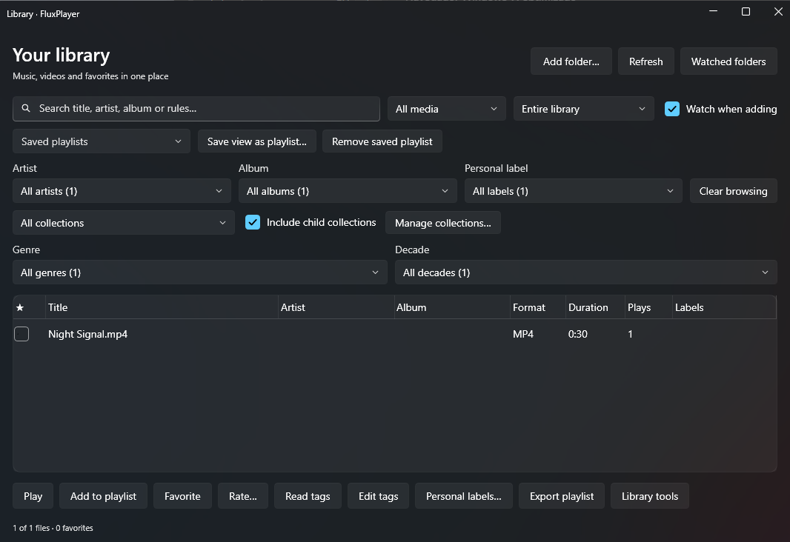](en/library.png)

### Graphic equalizer

[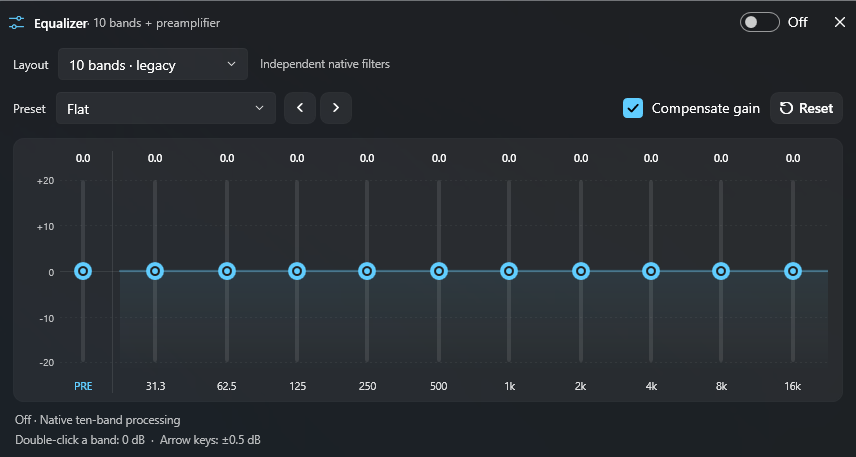](en/equalizer.png)

### Searchable settings

[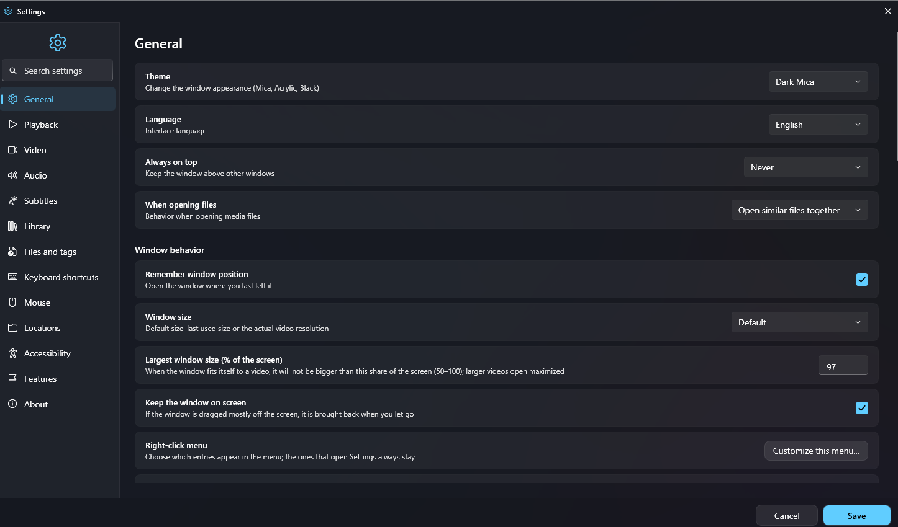](en/settings.png)

## Español

### Mica oscuro con el reproductor activo

[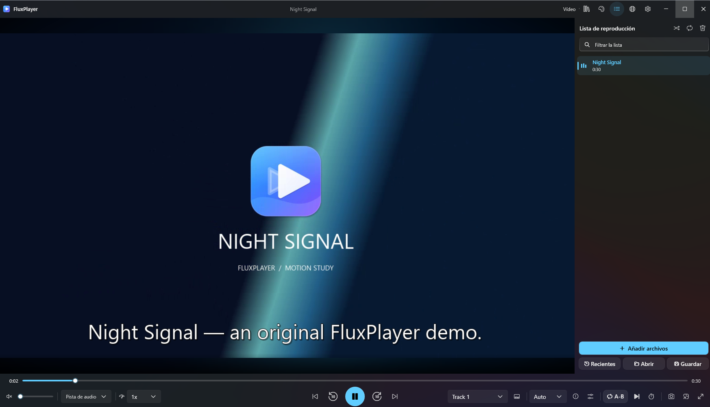](es/mica-dark.png)

### Mica claro

[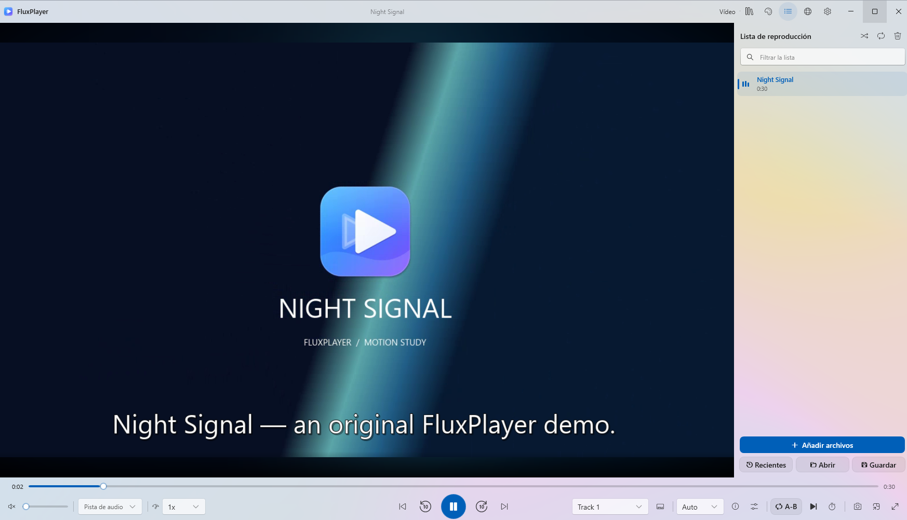](es/mica-light.png)

### Acrílico

[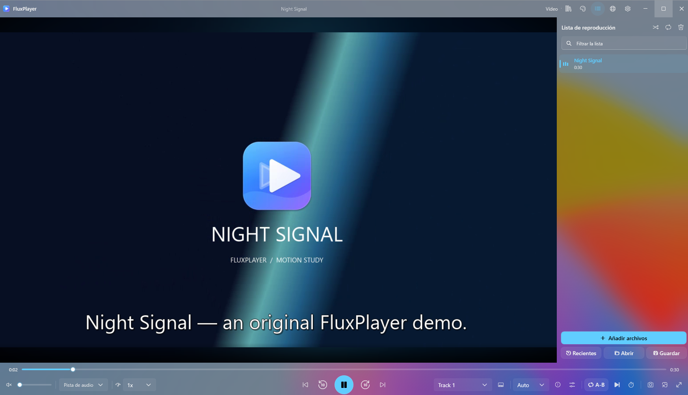](es/acrylic.png)

### Negro total

[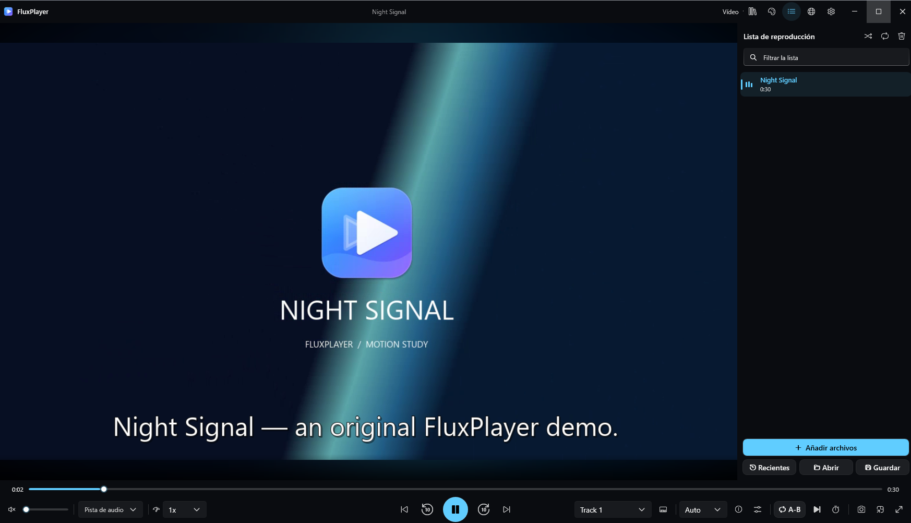](es/full-black.png)

### Modo música y lista de reproducción

[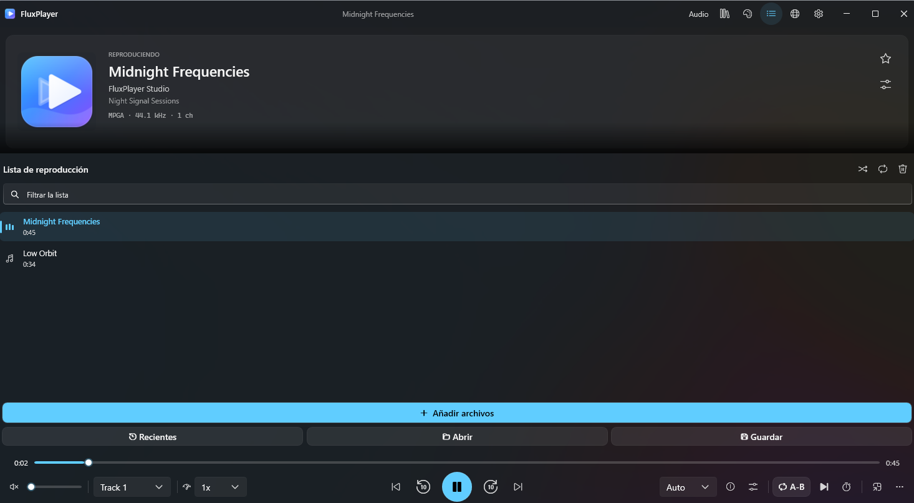](es/music.png)

### Biblioteca y filtros

[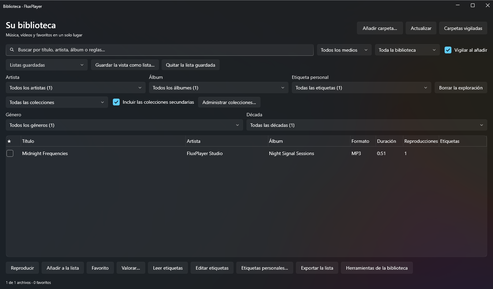](es/library.png)

### Ecualizador gráfico

[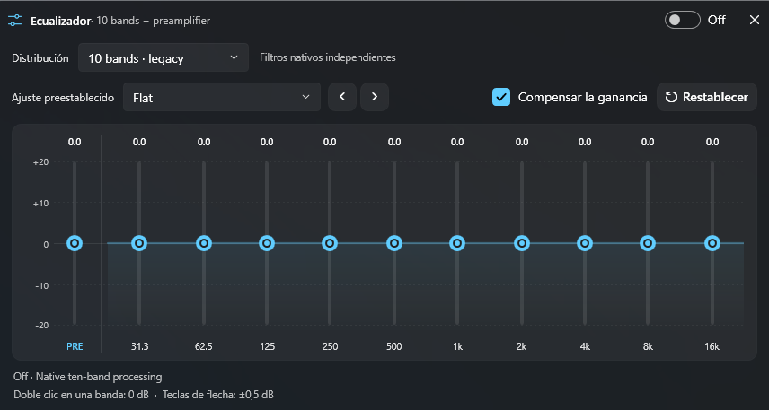](es/equalizer.png)

### Ajustes con búsqueda

[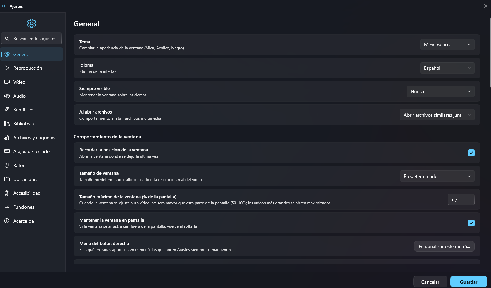](es/settings.png)
